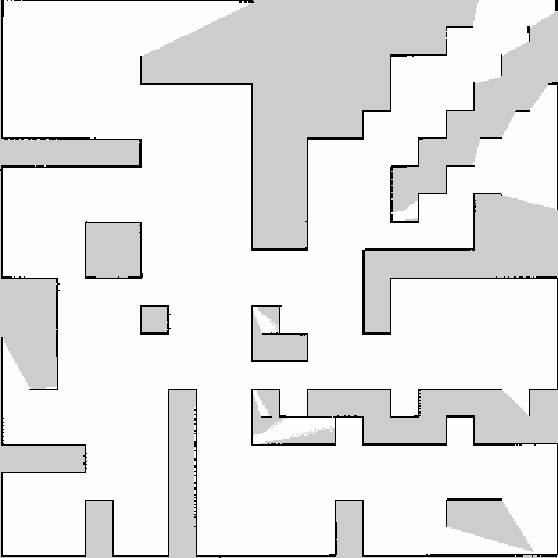
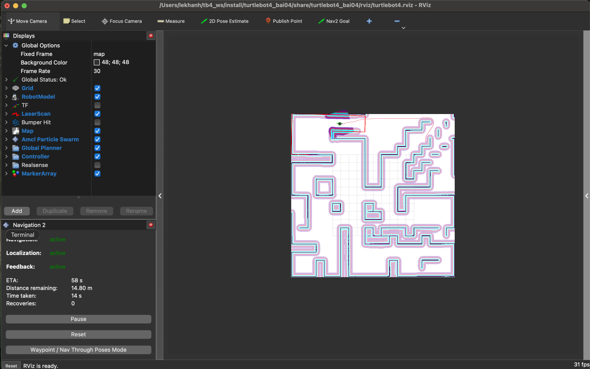

# turtlebot4_bai04 — Bài 04: TurtleBot 4 SLAM + Nav2 (simulation)

TurtleBot 4 Lite in Ignition Gazebo (Fortress), ROS 2 Humble: map the `maze` world with
SLAM Toolbox, save the map, localize on it with AMCL, then navigate autonomously with Nav2.
Runs headless on macOS (RoboStack); RViz2 is the viewer.

**Video demo:** https://drive.google.com/file/d/1FOBXRF59qovkcJb_21xw-_dbLqq39YfU/view?usp=sharing

```
Gazebo (TurtleBot 4: RPLIDAR, Create 3 base) --/scan /odom /tf--> SLAM Toolbox --/map--> map.yaml + map.pgm
map.yaml --> map_server + AMCL (map->odom) --> Nav2 (planner, controller, behaviors) --/cmd_vel--> robot
```

## Contents

- `launch/sim.launch.py` — Gazebo + TurtleBot 4 + bridges + Create 3 nodes; `slam:=true`,
  `localization:=true`, `nav2:=true` include the TurtleBot 4 navigation launch files.
- `config/` — `slam.yaml`, `localization.yaml` (AMCL), `nav2.yaml`.
- `maps/map.yaml`, `maps/map.pgm` — the maze map built with SLAM Toolbox.
- `rviz/turtlebot4.rviz` — map, scan, robot, costmaps, paths, AMCL particles, Nav2 Goal.
- `scripts/` — `demo.sh` (all four parts in one run), `check_topics.py` (/scan, /odom, /cmd_vel),
  `explore_route.py` (drives the robot for mapping), `compare_pose.py` (localized vs Gazebo pose),
  `send_goals.py` / `watch_goals.py` (Nav2 goals from the command line / from RViz), `stop_sim.sh`.
- `macos/` — patch + build script for Gazebo's ogre renderer on macOS (see below).

## Build

```bash
mkdir -p ~/tb4_ws/src && cd ~/tb4_ws/src
git clone https://github.com/Khanhkhan1/turtlebot4_bai04.git
vcs import . < turtlebot4_bai04/dependencies.repos   # turtlebot4, turtlebot4_simulator, create3_sim
# + ROS 2 Humble with Nav2, SLAM Toolbox, teleop_twist_keyboard, ros_gz / ros_ign
cd ~/tb4_ws && colcon build --symlink-install
./src/turtlebot4_bai04/macos/build_ogre_plugin.sh     # macOS only
```

## Run

```bash
source ~/tb4_ws/install/setup.zsh
export ROS_LOCALHOST_ONLY=1 IGN_IP=127.0.0.1     # in every terminal

# Phần 1 – robot, /scan, /odom, /cmd_vel
ros2 launch turtlebot4_bai04 sim.launch.py
ros2 run turtlebot4_bai04 check_topics.py

# Phần 2 – SLAM with teleop, then save the map
ros2 launch turtlebot4_bai04 sim.launch.py slam:=true
ros2 run teleop_twist_keyboard teleop_twist_keyboard
ros2 run nav2_map_server map_saver_cli -f ~/tb4_ws/src/turtlebot4_bai04/maps/map

# Phần 3 + 4 – AMCL on the saved map, then Nav2 goals with "Nav2 Goal" in RViz
ros2 launch turtlebot4_bai04 sim.launch.py localization:=true nav2:=true
ros2 run turtlebot4_bai04 compare_pose.py

# All four parts in one command: map saved to ~/tb4_demo; --teleop drives with the keyboard,
# --rviz-goals waits for three "Nav2 Goal" clicks in RViz
ros2 run turtlebot4_bai04 demo.sh
```

## Results

- Map vs. the true maze walls: within 2–7 cm (5 cm cells).
- Localization vs. Gazebo ground truth while navigating: median 7 cm, max 11 cm.
- Three goals in different parts of the maze: all reached, no manual control, no collision.

| Map (SLAM Toolbox) | Navigation (Nav2) |
|---|---|
|  |  |

## macOS notes

- Gazebo's GPU lidar (`ogre` renderer) returns every ray at `range_min` on Apple Silicon.
  `macos/build_ogre_plugin.sh` builds a patched renderer (scan stitched on the CPU) that
  the launch file then uses automatically.
- The Create 3 cliff/IR sensors are left out of the simulation (`proximity_sensors:=true`
  keeps them); SLAM, AMCL and Nav2 only use the RPLIDAR and odometry.
